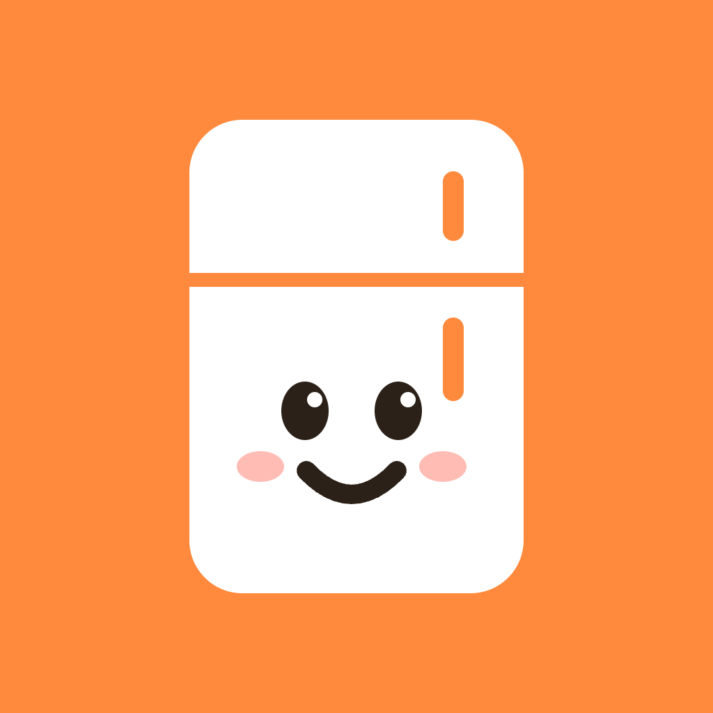

<p align="center">
  
</p>

<h1 align="center">FridgeMates</h1>

<p align="center">
  🏆 <b>Winner, SURGE Prize Track, SFU Fall Hacks 2026</b>
</p>

<p align="center">
  <b>Can you name everything in your fridge? And what's expiring this week?</b><br/>
  FridgeMates keeps track of your fridge from one photo, so you always know what you have and what to eat first.
</p>

<p align="center">
  <a href="https://www.youtube.com/watch?v=XU6VGoLsIII">Demo video</a> · <a href="https://devpost.com/software/fridgemates?ref_content=user-portfolio&ref_feature=in_progress">Devpost</a>
</p>

## Why
It's hard to keep track of what's in your fridge. Food gets pushed to the back, forgotten, and thrown out, or you buy something you already had. Canadian households waste about $1,300 of food a year (Love Food Hate Waste Canada). Other fridge apps make you type in every item, so nobody keeps using them.

## What it does
- **Scan with one photo:** Gemini finds each item, counts it, and estimates when it expires. Fix quantities or remove mistakes, then add everything in one tap.
- **Sorted by what expires first:** one searchable list of your whole fridge.
- **Food moods:** each item's mood shows how urgent it is, from *Cocky* (lots of time) to *Dramatic* (eat today). Forgotten food becomes a *Ghost*.
- **Ate it? One tap:** mark food as eaten or adjust any date.
- **Overview:** swipe to see everything by category.
- **Ask Jeppy:** your fridge manager answers suggested questions like "What should I cook?"
- **Reminders:** your food texts you before it expires, at most twice a day.

## How it works
1. You take a photo in the app.
2. The app sends it to our Node + Express backend.
3. The backend asks the **Google Gemini API** for each item's name, quantity, and shelf life as structured JSON.
4. The app saves everything on your phone, sorts it, and schedules reminders.

Expiry dates use the printed date when Gemini can see it, otherwise an estimate. You can always edit them. They're "use soon" reminders, not food safety advice.

## Tech stack
- **App:** Expo (React Native + TypeScript), Expo Router, Reanimated, expo-notifications, AsyncStorage
- **Backend:** Node + Express + TypeScript, deployed on Render
- **AI:** Google Gemini API

## Run it locally

**Backend**
```bash
cd backend
cp .env.example .env   # add your Gemini API key
npm install
npm run dev
```

**iPhone app**
```bash
cd mobile
npm install
# set EXPO_PUBLIC_API_URL in mobile/.env to your backend URL
npx expo run:ios --device
```

## Team
- **Rainier:** UI/UX design and the iOS app
- **Kenneth:** Gemini backend
- **Kerwin:** search, sort, and quantity features

## Credits
- Mascot Jeppy courtesy of the SFU Fall Hacks / CSSS organizers
- Icons: [Microsoft Fluent Emoji](https://github.com/microsoft/fluentui-emoji) (MIT)
